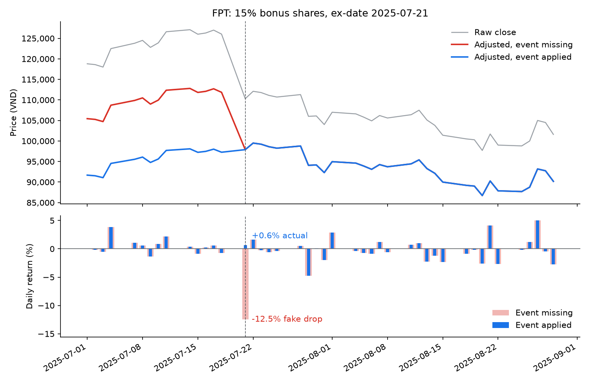
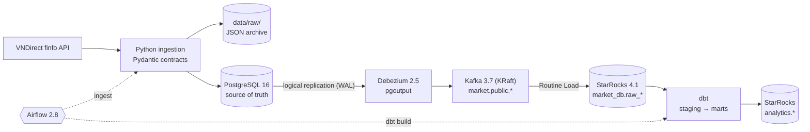

# Market CDC Pipeline

Change-data-capture pipeline for Vietnamese equities (VN30). Raw daily prices and corporate actions live in PostgreSQL; Debezium streams every change through Kafka into StarRocks; dbt turns them into **corporate-action-adjusted** prices and indicators; Airflow orchestrates the daily run.

```
VNDirect API → PostgreSQL → Debezium → Kafka → StarRocks → dbt → analytics marts
                                  orchestrated by Airflow
```

## The problem

Vietnamese stock prices "break" on every ex-date (ngày GDKHQ): cash dividends, stock dividends, bonus shares and rights issues all push the reference price down overnight. Compute returns or moving averages on raw prices and you get crashes that never happened.

FPT, 15% bonus shares, ex-date 2025-07-21 (actual output of this pipeline):

| Date | Raw close (VND) | Raw return | Adjusted close | Adjusted return |
|---|---:|---:|---:|---:|
| 2025-07-18 | 126,030 | −0.76% | 97,263 | −0.76% |
| 2025-07-21 | 110,300 | **−12.48%** | 97,892 | **+0.65%** |

Adjusted prices are in today's share terms, so they also include FPT's later events (cash dividends 2025-12-01 and 2026-05-28, 10% bonus 2026-09-21).

Two things make this a data engineering problem rather than a one-off calculation:

1. **One event rewrites the whole history.** A new corporate action changes the adjusted price of every earlier session of that stock.
2. **Events change after they are announced.** Corporate actions get corrected, rescheduled or cancelled, and prices occasionally get corrected too.

So the pipeline keeps **raw prices and events as the immutable source of truth** in Postgres, captures every change from the write-ahead log instead of reloading tables, and recomputes adjusted history in the warehouse.

## Demo: one corporate action through CDC

`make demo` ([scripts/simulate_corporate_action.py](scripts/simulate_corporate_action.py)) replays the FPT event above on real prices:

1. Deletes the event in Postgres. CDC removes it from StarRocks, dbt rebuilds: the ex-date return becomes a fake **−12.48%**, and the dbt test `assert_reference_price_gaps_have_events` fails because the exchange moved the reference price on a day with no event.
2. Inserts the event again. CDC delivers it, `dbt build` passes (30/30): the return is back to **+0.65%**.
3. Measures CDC latency from the Postgres commit until the change is visible in StarRocks.



Measured on a laptop: **4–8 s** from Postgres commit to StarRocks, most of it Routine Load's batch interval (`max_batch_interval` 10 s). The event is always restored, even if the script fails halfway.

## Architecture



| Layer | Tech | What it does |
|---|---|---|
| Source | VNDirect finfo API | Raw (unadjusted) daily OHLCV, corporate action events, instrument info |
| Ingestion | Python, Pydantic, psycopg2 | Validates each row (bad rows go to `data/quarantine/`), archives raw JSON, upserts into Postgres only when a value actually changed |
| OLTP | PostgreSQL 16 | `daily_bar`, `corporate_action`, `instrument`; `wal_level=logical`, publication for Debezium |
| CDC | Debezium 2.5 + Kafka 3.7 | One topic per table (`market.public.<table>`) |
| Warehouse | StarRocks 4.1 | Routine Load jobs pull each topic into Primary Key tables |
| Transform | dbt (dbt-starrocks) | Staging views, adjustment factors, adjusted prices, SMA and returns |
| Orchestration | Airflow 2.8 (LocalExecutor) | `market_daily` (17:00 Mon–Fri, `Asia/Ho_Chi_Minh`): ingest → wait for CDC sync (sensor) → source freshness → dbt build. `market_backfill`: same ingestion function, manual trigger with parameters |

## How price adjustment works

Each event yields a factor that applies to every session **before** its ex-date. The cumulative factor for a session is the product of the factors of all later events, and `adj_price = raw_price × cumulative_factor`.

The factor of an ex-date is `P_ref / P_prev`, where `P_prev` is the raw close of the previous session and `P_ref` is the reference price the exchange sets for the ex-date:

```
P_ref = (P_prev − D + r_rights · S) / (1 + r_stock + r_rights)
```

| Event | Enters the formula as |
|---|---|
| Cash dividend, *D* VND/share | `D` |
| Stock dividend, bonus shares (ratio *r*) | `r_stock` |
| Rights issue (ratio *r*, subscription price *S*) | `r_rights`, `S` |

All events of one stock on the same ex-date are combined in **one** formula, the way the exchange does it. Multiplying separate factors is wrong when events coincide: `1/((1+r1)(1+r2)) ≠ 1/(1+r1+r2)`. Example: SSI 2024-09-23, previous close 33,600, with a 1,000 VND cash dividend, a 20% stock dividend and 10% rights at 15,000 on the same day: `(33,600 − 1,000 + 0.1 × 15,000) / (1 + 0.2 + 0.1) = 26,231`, against the exchange's 26,250.

A dbt test checks the computed `P_ref` against the reference price published by the exchange for every ex-date (max 0.5% off; the gap is tick-size rounding). Only events whose ex-date has passed are applied. See [int_adjustment_factor.sql](market_cdc/models/intermediate/int_adjustment_factor.sql) and [int_adjusted_bars.sql](market_cdc/models/intermediate/int_adjusted_bars.sql).

## Quick start

Requirements: Docker with Compose v2, plus `make` and `bash` (on Windows, use Git Bash and the commands in the second block).

```bash
make init     # build + start the stack, then create topics, tables, connector, Routine Load jobs, unpause the DAGs
make status   # services, connector state, Routine Load state, row counts Postgres vs StarRocks
```

Without `make`:

```bash
cp .env.example .env
docker compose up -d --build --wait --wait-timeout 300
bash scripts/init.sh
```

`init` is idempotent: run it again at any time, finished steps are skipped or updated. Once `market_daily` is unpaused, Airflow runs it once straight away.

| Service | Address | Login |
|---|---|---|
| Airflow | http://localhost:8088 | `admin` / `admin` |
| Kafka UI (topics + Debezium connector) | http://localhost:8085 | – |
| Kafka Connect REST | http://localhost:8083 | – |
| StarRocks FE UI | http://localhost:8030 | `root`, no password |
| StarRocks SQL (MySQL protocol) | `localhost:9030` | `root`, no password |
| PostgreSQL (source) | `localhost:5435`, db `market_db` | `postgres` / `postgres` |
| Kafka (from host) | `localhost:9092` | – |

Credentials come from `.env` (copied from [.env.example](.env.example)). Postgres reads them only when its volume is first created; after changing them, run `make reset`.

| Command | Effect |
|---|---|
| `make up` | Build and start the stack, wait until healthy |
| `make init` | `up` + initialise the pipeline |
| `make status` | Pipeline health summary |
| `make ingest` | Trigger the daily DAG now |
| `make demo` | Run the corporate action demo (host venv, see [Demo](#demo-one-corporate-action-through-cdc)) |
| `make down` | Stop the stack, keep data |
| `make reset` | Stop the stack and **delete all volumes** |

## Loading data

`market_daily` reloads the last 5 days for the whole VN30 basket, counted back from the run's `data_interval_end`, so a missed session or a late correction at the source is picked up by the next run. It runs with `catchup=False`: the lookback window already covers missed runs. Re-running an old run reloads exactly the same window.

To load history, trigger `market_backfill` from the Airflow UI (*Trigger DAG w/ config*: symbols one per line, empty = VN30; `start_date` required; `end_date` empty = today) or from the CLI:

```bash
docker compose exec airflow airflow dags trigger market_backfill \
  -c '{"symbols": ["FPT", "HPG"], "start_date": "2025-07-01", "end_date": null}'
```

It runs the same ingestion function, waits for CDC, then runs `dbt build`. A task that fails after its retry is logged by `on_failure_callback`, and posted to Slack when `SLACK_WEBHOOK_URL` is set in `.env`.

The same function is available as a CLI from the host:

```bash
python -m venv .venv
source .venv/Scripts/activate      # Linux/macOS: source .venv/bin/activate
pip install -r requirements.txt

python ingestion/batch/backfill_ingest.py                                       # VN30, resumes per symbol
python ingestion/batch/backfill_ingest.py --symbols FPT HPG --start-date 2025-07-01
```

Without dates, each symbol resumes from its latest `trade_date` minus 5 days, or loads one year if it has no data yet. Re-running a window is safe: unchanged rows produce no CDC events.

Then rebuild the models:

```bash
cd market_cdc
dbt build --profiles-dir .
```

And query the result in StarRocks:

```sql
SELECT trade_date, close, adj_close, daily_return_pct, sma_20
FROM analytics.fct_daily_bars
WHERE symbol = 'FPT' AND trade_date BETWEEN '2025-07-16' AND '2025-07-23'
ORDER BY trade_date;
```

## Data model

| Schema | Model | Materialization | Content |
|---|---|---|---|
| `market_db` | `raw_daily_bar`, `raw_corporate_action`, `raw_instrument` | Primary Key table | Latest row per key from CDC, plus `op`, `op_ts`, `_ingest_at` |
| `analytics` | `stg_daily_bar`, `stg_corporate_action`, `stg_instrument` | view | Typed columns, CDC metadata renamed, deletes are applied upstream (Routine Load maps them to StarRocks __op) |
| `analytics` | `int_adjustment_factor` | view | One row per (symbol, ex-date): `P_prev`, computed `P_ref`, factor |
| `analytics` | `int_adjusted_bars` | view | Raw OHLCV, cumulative factor, adjusted prices |
| `analytics` | `int_daily_bar_indicators` | view | SMA 20/50, volume SMA 20, daily return on adjusted close (`NULL` until the window is full) |
| `analytics` | `fct_daily_bars` | table | Raw OHLCV + adjusted close + indicators |
| `analytics` | `fct_corporate_actions`, `dim_instrument` | table | Events and instrument dimension |

Data quality:

- **Ingestion:** Pydantic validates each row (prices > 0, `high >= low`, `ceiling >= floor`, required fields per event type). A bad row is written to `data/quarantine/<date>/<symbol>.json` and the rest is loaded. The run fails at the end if a symbol failed, if a symbol lost every row, or if more than 1% of rows were rejected.
- **Before dbt:** an Airflow sensor waits until StarRocks matches Postgres (row counts and `max(updated_at)` per table) and fails fast if a Routine Load job is not `RUNNING`. Then `dbt source freshness` (warn after 4 days, error after 10).
- **dbt tests:** `not_null`, `unique`, `relationships`, plus:
  - `assert_reference_price_matches_exchange`: computed `P_ref` vs the exchange's reference price on every ex-date.
  - `assert_reference_price_gaps_have_events`: on HOSE/HNX the reference price equals the previous close except on ex-dates, so a gap with no event means a **missing** event.
  - `assert_prices_within_daily_limits`: high/low within the exchange's ceiling/floor for that session.
  - `assert_positive_prices`.

## Design decisions

- **Raw prices are never adjusted in place.** Writing adjusted prices back to the source would mean rewriting hundreds of rows per event, with no clean way to undo a cancelled event. Postgres keeps raw prices and events; dbt derives the adjusted history.
- **Log-based CDC instead of reloads.** Debezium reads the Postgres WAL, so corrections to events and prices reach the warehouse without full reloads or polling `updated_at`.
- **Upserts only write when something changed.** `ON CONFLICT … DO UPDATE … WHERE (…) IS DISTINCT FROM (…)` keeps overlapping re-runs from flooding Kafka with no-op updates. Verified: running the same backfill twice produces 0 Kafka events; editing one price produces exactly one `u` event.
- **Deletes reach the warehouse.** Debezium's `ExtractNewRecordState` flattens events and rewrites deletes as `__deleted=true`; Routine Load maps that to StarRocks' `__op=1`, which removes the row from the Primary Key table. A cancelled corporate action therefore disappears from the adjusted history after the next `dbt build`.
- **No `merge_condition` for ordering.** Each topic has one partition keyed by primary key, and Routine Load commits rows and offsets in one transaction, so events are applied in commit order and a replay from the beginning converges to the latest state. This needs revisiting only if topics get more partitions without keying by primary key.
- **StarRocks Routine Load instead of a Kafka Connect sink.** StarRocks pulls from Kafka itself, so there is no sink plugin to deploy, and each load task commits rows and offsets together. Primary Key tables make replays idempotent.
- **Bounded WAL retention.** `max_slot_wal_keep_size=2048MB`: if Debezium stays down too long, Postgres drops the replication slot instead of filling the disk. Recovery is to re-register the connector and let it re-snapshot.
- **The source must return raw prices.** yfinance (even with `auto_adjust=False`), DNSE and VCI all return prices already adjusted for stock dividends, which would be adjusted twice. VNDirect returns raw prices; [an integration test](tests/test_vndirect_source.py) checks the FPT gap at its ex-date against the live API.
- **No secrets in config files.** The connector JSON references `${env:POSTGRES_PASSWORD}` through Kafka Connect's `EnvVarConfigProvider`; all credentials come from `.env`.
- **dbt in its own virtualenv** inside the Airflow image, so dbt and Airflow dependencies never conflict.

## Tests

```bash
pytest -m "not integration"   # unit tests, no network
pytest                        # also hits the live VNDirect API
```

Unit tests use a fake HTTP session to check price units, pagination, event mapping (same-day events are combined), row rejection and instrument parsing. Orchestration tests cover the daily window, symbol parsing, the failure callback, and that one failing symbol does not stop the others.

## Status and roadmap

Working today: the full flow from the API to the marts for VN30, adjustment for cash dividends, stock dividends, bonus shares and rights issues, deletes propagated through CDC, idempotent ingestion with row-level quarantine, the reconciliation sensor and dbt tests, a parameterised backfill DAG, the CDC demo, one-command setup.

Next:

- **Modeling:** a trading calendar (`dim_date`) and SCD2 history for `dim_instrument` (e.g. MCH moved from UPCoM to HOSE on 2025-12-25).
- **CI:** GitHub Actions running pytest, `dbt parse` and lint.

## Project structure

```
.
├── airflow/              # Airflow image (dbt in a separate venv), DAGs market_daily and market_backfill
├── assets/               # README images
├── debezium/connectors/  # Postgres source connector config
├── ingestion/
│   ├── source/           # VNDirect client, Pydantic contracts, Postgres loader
│   ├── batch/            # run_backfill: shared by both DAGs and the CLI
│   └── monitoring/       # CDC reconciliation check, failure alerts
├── market_cdc/           # dbt project
├── postgres/init/        # OLTP schema, updated_at triggers, publication, Debezium user
├── scripts/              # init.sh, status.sh, simulate_corporate_action.py (demo)
├── starrocks/ddl/        # Raw tables, one Routine Load job per topic
├── tests/                # pytest: unit + live API
├── docker-compose.yml
└── Makefile
```
