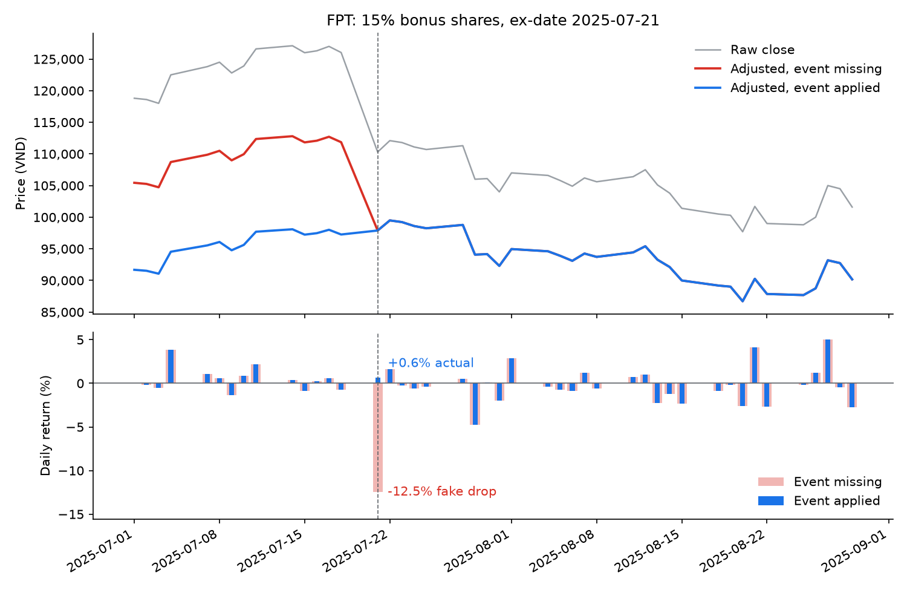
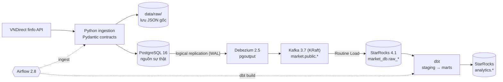

# Market CDC Pipeline

[English](README.md) · **Tiếng Việt**

Pipeline change data capture (CDC) cho cổ phiếu Việt Nam (rổ VN30). Giá ngày thô và sự kiện quyền nằm ở PostgreSQL; Debezium đẩy mọi thay đổi qua Kafka vào StarRocks; dbt tính ra giá **đã điều chỉnh theo sự kiện quyền** cùng các chỉ báo; Airflow điều phối lịch chạy hằng ngày.

```
VNDirect API → PostgreSQL → Debezium → Kafka → StarRocks → dbt → analytics marts
                                  điều phối bởi Airflow
```

## Bài toán

Giá cổ phiếu Việt Nam bị "gãy" ở mỗi ngày giao dịch không hưởng quyền (GDKHQ): cổ tức tiền mặt, cổ tức bằng cổ phiếu, cổ phiếu thưởng, quyền mua đều làm giá tham chiếu giảm qua một đêm. Tính lợi suất hay đường trung bình trên giá thô sẽ thấy những cú sập không hề xảy ra.

FPT thưởng 15% cổ phiếu, GDKHQ 2025-07-21 (số liệu thật do pipeline này tính):

| Ngày | Giá đóng cửa thô (VND) | Lợi suất thô | Giá điều chỉnh | Lợi suất điều chỉnh |
|---|---:|---:|---:|---:|
| 2025-07-18 | 126,030 | −0.76% | 97,263 | −0.76% |
| 2025-07-21 | 110,300 | **−12.48%** | 97,892 | **+0.65%** |

Giá điều chỉnh quy về số cổ phiếu hiện tại, nên đã gồm cả các sự kiện sau đó của FPT (cổ tức tiền 2025-12-01 và 2026-05-28, thưởng 10% ngày 2026-09-21).

Hai điều khiến đây là bài toán data engineering chứ không phải một phép tính làm một lần:

1. **Một sự kiện viết lại toàn bộ lịch sử.** Thêm một sự kiện quyền là giá điều chỉnh của mọi phiên trước đó của mã đó đều thay đổi.
2. **Sự kiện thay đổi sau khi đã công bố.** Sự kiện quyền bị đính chính, dời ngày hoặc huỷ; giá đôi khi cũng bị đính chính.

Vì vậy pipeline giữ **giá thô và sự kiện làm nguồn sự thật bất biến** ở Postgres, bắt mọi thay đổi từ write-ahead log (WAL) thay vì nạp lại cả bảng, và tính lại lịch sử giá điều chỉnh trong warehouse.

## Demo

`make demo` ([scripts/simulate_corporate_action.py](scripts/simulate_corporate_action.py)) chạy lại sự kiện FPT ở trên trên giá thật, để thấy một sự kiện quyền đi qua CDC:

1. Xoá sự kiện ở Postgres. CDC xoá nó ở StarRocks, dbt build lại: lợi suất ngày GDKHQ thành **−12.48%** giả, và dbt test `assert_reference_price_gaps_have_events` báo lỗi vì sàn đổi giá tham chiếu vào một ngày không có sự kiện nào.
2. Nạp lại sự kiện. CDC đưa nó sang, `dbt build` xanh (36/36): lợi suất trở về **+0.65%**.
3. Đo độ trễ CDC, từ lúc commit ở Postgres tới lúc thấy được ở StarRocks.



Đo trên laptop qua 12 lần chạy: **2–10 giây** từ lúc commit ở Postgres tới StarRocks, phần lớn là chu kỳ gom batch của Routine Load (`max_batch_interval` 10 giây). Sự kiện luôn được nạp lại, kể cả khi script lỗi giữa chừng.

## Kiến trúc



| Tầng | Công nghệ | Vai trò |
|---|---|---|
| Nguồn | VNDirect finfo API | OHLCV ngày chưa điều chỉnh, sự kiện quyền, thông tin mã |
| Ingestion | Python, Pydantic, psycopg2 | Validate từng dòng (dòng lỗi đưa vào `data/quarantine/`), lưu JSON gốc, upsert vào Postgres chỉ khi giá trị thật sự thay đổi |
| OLTP | PostgreSQL 16 | `daily_bar`, `corporate_action`, `instrument`; `wal_level=logical`, publication cho Debezium |
| CDC | Debezium 2.5 + Kafka 3.7 | Mỗi bảng một topic (`market.public.<table>`) |
| Warehouse | StarRocks 4.1 | Job Routine Load kéo từng topic vào bảng Primary Key |
| Transform | dbt (dbt-starrocks) | View staging, hệ số điều chỉnh, giá điều chỉnh, SMA và lợi suất |
| Điều phối | Airflow 2.8 (LocalExecutor) | `market_daily` (17:00 thứ 2–6, giờ `Asia/Ho_Chi_Minh`): ingest → chờ CDC khớp (sensor) → source freshness → dbt build. `market_backfill`: cùng hàm ingestion, trigger tay kèm tham số |

## Cách điều chỉnh giá

Mỗi sự kiện tạo ra một hệ số, áp cho mọi phiên **trước** ngày GDKHQ của nó. Hệ số luỹ kế của một phiên là tích hệ số của mọi sự kiện xảy ra sau phiên đó, và `giá điều chỉnh = giá thô × hệ số luỹ kế`.

Hệ số của một ngày GDKHQ là `P_ref / P_prev`, trong đó `P_prev` là giá đóng cửa thô của phiên liền trước, còn `P_ref` là giá tham chiếu sàn đặt cho ngày GDKHQ:

```
P_ref = (P_prev − D + r_rights · S) / (1 + r_stock + r_rights)
```

| Sự kiện | Vào công thức dưới dạng |
|---|---|
| Cổ tức tiền mặt, *D* VND/cổ phiếu | `D` |
| Cổ tức bằng cổ phiếu, cổ phiếu thưởng (tỷ lệ *r*) | `r_stock` |
| Quyền mua (tỷ lệ *r*, giá phát hành *S*) | `r_rights`, `S` |

Mọi sự kiện của một mã trong cùng một ngày GDKHQ được gộp vào **một** công thức, đúng như cách sàn tính. Nhân các hệ số riêng lẻ sẽ sai khi sự kiện trùng ngày: `1/((1+r1)(1+r2)) ≠ 1/(1+r1+r2)`. Ví dụ SSI ngày 2024-09-23, giá đóng cửa phiên trước 33,600, cùng lúc có cổ tức tiền 1,000 VND, cổ tức cổ phiếu 20% và quyền mua 10% giá 15,000: `(33,600 − 1,000 + 0.1 × 15,000) / (1 + 0.2 + 0.1) = 26,231`, so với 26,250 của sàn.

Một dbt test so `P_ref` tự tính với giá tham chiếu sàn công bố ở mọi ngày GDKHQ (lệch tối đa 0.5%; phần lệch là do làm tròn theo bước giá). Chỉ áp các sự kiện đã qua ngày GDKHQ. Xem [int_adjustment_factor.sql](market_cdc/models/intermediate/int_adjustment_factor.sql) và [int_adjusted_bars.sql](market_cdc/models/intermediate/int_adjusted_bars.sql).

## Chạy nhanh

Yêu cầu: Docker có Compose v2, cùng `make` và `bash` (trên Windows dùng Git Bash và các lệnh ở khối thứ hai).

```bash
make init     # build + khởi động stack, rồi tạo topic, bảng, connector, job Routine Load, bật các DAG
make status   # trạng thái service, connector, Routine Load, số dòng Postgres so với StarRocks
```

Sau đó nạp lịch sử (VN30 từ 2025-07-01: chạy DAG `market_backfill` và chờ xong) rồi chạy demo:

```bash
make seed     # hoặc: bash scripts/seed.sh
make demo     # venv trên host: pip install -r requirements.txt
```

Không có `make`:

```bash
cp .env.example .env
docker compose up -d --build --wait --wait-timeout 300
bash scripts/init.sh
```

`init` idempotent: chạy lại lúc nào cũng được, bước đã xong sẽ được bỏ qua hoặc cập nhật. Khi `market_daily` được bật, Airflow chạy nó một lần ngay.

| Service | Địa chỉ | Đăng nhập |
|---|---|---|
| Airflow | http://localhost:8088 | `admin` / `admin` |
| Kafka UI (topic + Debezium connector) | http://localhost:8085 | – |
| Kafka Connect REST | http://localhost:8083 | – |
| StarRocks FE UI | http://localhost:8030 | `root`, không mật khẩu |
| StarRocks SQL (giao thức MySQL) | `localhost:9030` | `root`, không mật khẩu |
| PostgreSQL (nguồn) | `localhost:5435`, db `market_db` | `postgres` / `postgres` |
| Kafka (từ máy host) | `localhost:9092` | – |

Thông tin đăng nhập lấy từ `.env` (copy từ [.env.example](.env.example)). Postgres chỉ đọc chúng khi volume được tạo lần đầu; đổi xong phải chạy `make reset`.

| Lệnh | Tác dụng |
|---|---|
| `make up` | Build và khởi động stack, chờ tới khi healthy |
| `make init` | `up` + khởi tạo pipeline |
| `make status` | Tóm tắt tình trạng pipeline |
| `make ingest` | Trigger DAG hằng ngày ngay |
| `make seed` | Nạp lịch sử VN30 từ 2025-07-01 qua `market_backfill`, chờ tới khi xong (`START=YYYY-MM-DD` để đổi) |
| `make demo` | Chạy demo sự kiện quyền (venv trên host, xem [Demo](#demo)) |
| `make down` | Dừng stack, giữ dữ liệu |
| `make reset` | Dừng stack và **xoá toàn bộ volume** |

## Nạp dữ liệu

`market_daily` nạp lại 5 ngày gần nhất cho cả rổ VN30, tính lùi từ `data_interval_end` của run, nên phiên bị lỡ hoặc dữ liệu nguồn sửa muộn sẽ được lấp ở run sau. DAG chạy với `catchup=False`: cửa sổ lùi 5 ngày đã lo phần run bị lỡ. Chạy lại một run cũ sẽ nạp đúng cửa sổ của run đó.

Để nạp lịch sử, trigger `market_backfill` từ Airflow UI (*Trigger DAG w/ config*: mỗi dòng một mã, để trống = VN30; `start_date` bắt buộc; `end_date` để trống = hôm nay) hoặc từ CLI:

```bash
docker compose exec airflow airflow dags trigger market_backfill \
  -c '{"symbols": ["FPT", "HPG"], "start_date": "2025-07-01", "end_date": null}'
```

DAG này chạy cùng hàm ingestion, chờ CDC, rồi `dbt build`. Task nào fail sau khi hết lượt retry sẽ được `on_failure_callback` ghi log, và gửi lên Slack nếu `.env` có `SLACK_WEBHOOK_URL`.

Cũng hàm đó có thể chạy bằng CLI từ máy host:

```bash
python -m venv .venv
source .venv/Scripts/activate      # Linux/macOS: source .venv/bin/activate
pip install -r requirements.txt

python ingestion/batch/backfill_ingest.py                                       # VN30, nạp tiếp theo từng mã
python ingestion/batch/backfill_ingest.py --symbols FPT HPG --start-date 2025-07-01
```

Không truyền ngày thì mỗi mã nạp tiếp từ `trade_date` mới nhất trừ 5 ngày, hoặc nạp một năm nếu chưa có dữ liệu. Chạy lại một cửa sổ là an toàn: dòng không đổi không sinh CDC event.

Sau đó build lại các model:

```bash
cd market_cdc
dbt build --profiles-dir .
```

Và truy vấn kết quả ở StarRocks:

```sql
SELECT trade_date, close, adj_close, daily_return_pct, sma_20
FROM analytics.fct_daily_bars
WHERE symbol = 'FPT' AND trade_date BETWEEN '2025-07-16' AND '2025-07-23'
ORDER BY trade_date;
```

## Mô hình dữ liệu

| Schema | Model | Materialization | Nội dung |
|---|---|---|---|
| `market_db` | `raw_daily_bar`, `raw_corporate_action`, `raw_instrument` | Bảng Primary Key | Bản mới nhất của mỗi khoá từ CDC, kèm `op`, `op_ts`, `_ingest_at` |
| `analytics` | `stg_daily_bar`, `stg_corporate_action`, `stg_instrument` | view | Ép kiểu cột, đổi tên metadata CDC; dòng bị xoá đã được loại từ trước (Routine Load map sang `__op` của StarRocks) |
| `analytics` | `int_adjustment_factor` | view | Một dòng cho mỗi (mã, ngày GDKHQ): `P_prev`, `P_ref` tự tính, hệ số |
| `analytics` | `int_adjusted_bars` | view | OHLCV thô, hệ số luỹ kế, giá điều chỉnh |
| `analytics` | `int_daily_bar_indicators` | view | SMA 20/50, SMA khối lượng 20, lợi suất ngày trên giá điều chỉnh (`NULL` khi chưa đủ cửa sổ) |
| `analytics` | `fct_daily_bars` | table | OHLCV thô + giá đóng cửa điều chỉnh + chỉ báo |
| `analytics` | `fct_corporate_actions` | table | Sự kiện quyền |
| `analytics_snapshots` | `snap_instrument` | dbt snapshot | Lịch sử SCD2 thông tin mã (strategy timestamp theo `updated_at` của nguồn) |
| `analytics` | `dim_instrument` | table | Mỗi phiên bản của mã một dòng: `valid_from`, `valid_to`, `is_current` |
| `analytics` | `dim_date` | table | Lịch ngày với `is_trading_day`, `is_holiday` (ngày thường sàn đóng cửa, suy ra từ dữ liệu) và `trade_day_no` |

Chất lượng dữ liệu:

- **Lúc ingestion:** Pydantic validate từng dòng (giá > 0, `high >= low`, `ceiling >= floor`, các trường bắt buộc theo từng loại sự kiện). Dòng lỗi được ghi vào `data/quarantine/<ngày>/<mã>.json`, phần còn lại vẫn được nạp. Cuối run sẽ fail nếu có mã bị lỗi, có mã mất hết dòng, hoặc hơn 1% số dòng bị loại.
- **Trước khi chạy dbt:** một sensor Airflow chờ tới khi StarRocks khớp Postgres (số dòng và `max(updated_at)` từng bảng), và fail ngay nếu có job Routine Load không ở trạng thái `RUNNING`. Sau đó là `dbt source freshness` (cảnh báo sau 4 ngày, lỗi sau 10 ngày).
- **dbt test:** `not_null`, `unique`, `relationships`, cùng với:
  - `assert_reference_price_matches_exchange`: `P_ref` tự tính so với giá tham chiếu sàn công bố ở mọi ngày GDKHQ.
  - `assert_reference_price_gaps_have_events`: trên HOSE/HNX giá tham chiếu bằng giá đóng cửa phiên trước, trừ ngày GDKHQ; nên giá tham chiếu lệch mà không có sự kiện nghĩa là đang **thiếu** sự kiện.
  - `assert_prices_within_daily_limits`: giá cao/thấp nằm trong biên độ trần/sàn của chính phiên đó.
  - `assert_positive_prices`.

## Quyết định thiết kế

- **Không bao giờ sửa giá thô tại chỗ.** Ghi giá điều chỉnh ngược về nguồn nghĩa là mỗi sự kiện phải sửa hàng trăm dòng, và không có cách gọn gàng để hoàn tác khi sự kiện bị huỷ. Postgres giữ giá thô và sự kiện; dbt suy ra lịch sử giá điều chỉnh.
- **CDC đọc log thay vì nạp lại.** Debezium đọc WAL của Postgres, nên các đính chính về sự kiện và giá tới được warehouse mà không cần nạp lại toàn bộ hay quét theo `updated_at`.
- **Upsert chỉ ghi khi có thay đổi.** `ON CONFLICT … DO UPDATE … WHERE (…) IS DISTINCT FROM (…)` giúp các lần chạy chồng cửa sổ không đẩy hàng loạt update rỗng vào Kafka. Đã kiểm chứng: chạy cùng một backfill hai lần sinh 0 event trên Kafka; sửa một giá sinh đúng một event `u`.
- **Lệnh xoá đi tới tận warehouse.** `ExtractNewRecordState` của Debezium làm phẳng event và ghi lại lệnh xoá thành `__deleted=true`; Routine Load map nó sang `__op=1` của StarRocks để xoá dòng khỏi bảng Primary Key. Nhờ vậy một sự kiện quyền bị huỷ sẽ biến mất khỏi lịch sử giá điều chỉnh sau lần `dbt build` tiếp theo.
- **Không dùng `merge_condition` để giữ thứ tự.** Mỗi topic có một partition, key theo khoá chính, và Routine Load commit dữ liệu cùng offset trong một transaction, nên event được áp đúng thứ tự commit và đọc lại từ đầu vẫn hội tụ về trạng thái mới nhất. Chỉ cần xem lại nếu tăng số partition mà không partition theo khoá chính.
- **Dùng StarRocks Routine Load thay cho Kafka Connect sink.** StarRocks tự kéo từ Kafka nên không phải triển khai plugin sink, và mỗi task nạp commit dữ liệu cùng offset. Bảng Primary Key giúp việc đọc lại idempotent.
- **Giới hạn dung lượng WAL giữ lại.** `max_slot_wal_keep_size=2048MB`: nếu Debezium chết quá lâu, Postgres bỏ replication slot thay vì để đầy ổ đĩa. Cách khôi phục là đăng ký lại connector và để nó snapshot lại.
- **Nguồn phải trả giá thô.** yfinance (kể cả với `auto_adjust=False`), DNSE và VCI đều trả giá đã điều chỉnh cổ tức cổ phiếu, áp thêm hệ số sẽ thành điều chỉnh hai lần. VNDirect trả giá thô; [một integration test](tests/test_vndirect_source.py) kiểm tra khoảng gãy của FPT tại ngày GDKHQ trên API thật.
- **Không để secret trong file cấu hình.** File JSON của connector tham chiếu `${env:POSTGRES_PASSWORD}` qua `EnvVarConfigProvider` của Kafka Connect; mọi thông tin đăng nhập lấy từ `.env`.
- **dbt chạy trong virtualenv riêng** bên trong image Airflow, để dependency của dbt và Airflow không bao giờ xung đột.

## Test

```bash
pytest -m "not integration"   # unit test, không cần mạng
pytest                        # gọi cả API VNDirect thật
```

Unit test dùng HTTP session giả để kiểm tra đơn vị giá, phân trang, ánh xạ sự kiện (sự kiện cùng ngày được gộp), loại bỏ dòng lỗi và đọc thông tin mã. Test điều phối kiểm tra cửa sổ ngày của DAG hằng ngày, chuẩn hoá danh sách mã, callback khi fail, và việc một mã lỗi không chặn các mã khác.

## Tình trạng và lộ trình

Đã chạy được: toàn bộ luồng từ API tới marts cho VN30; điều chỉnh cổ tức tiền, cổ tức cổ phiếu, cổ phiếu thưởng và quyền mua; lệnh xoá đi qua CDC; ingestion idempotent kèm quarantine từng dòng; sensor đối soát và dbt test; DAG backfill có tham số; lịch giao dịch và lịch sử SCD2 thông tin mã; demo CDC; dựng toàn bộ bằng một lệnh.

CI (GitHub Actions) chạy ruff, pytest, `dbt parse` và `docker compose config` mỗi lần push.

Lỗi đã biết của adapter (dbt-starrocks 1.12.2) và cách repo xử lý:

- **Snapshot:** bước merge của adapter dùng `UPDATE` nhiều bảng kiểu MySQL, StarRocks không hỗ trợ. [macros/snapshot_merge.sql](market_cdc/macros/snapshot_merge.sql) thay bằng `INSERT OVERWRITE` để đóng các phiên bản cũ; một `pre_hook` xoá bảng tạm mà lần chạy lỗi để lại.
- **Kết nối:** adapter coi mọi lỗi kết nối là "chưa có database" và chạy `CREATE DATABASE`, nên các thread song song tranh nhau tạo trên warehouse mới. `init` tạo sẵn database `analytics`.

## Cấu trúc thư mục

```
.
├── .github/workflows/    # CI: ruff, pytest, dbt parse
├── airflow/              # Image Airflow (dbt trong venv riêng), DAG market_daily và market_backfill
├── assets/               # Hình cho README
├── debezium/connectors/  # Cấu hình connector nguồn Postgres
├── ingestion/
│   ├── source/           # Client VNDirect, Pydantic contracts, loader Postgres
│   ├── batch/            # run_backfill: dùng chung cho hai DAG và CLI
│   └── monitoring/       # Kiểm tra đối soát CDC, cảnh báo khi fail
├── market_cdc/           # Project dbt
├── postgres/init/        # Schema OLTP, trigger updated_at, publication, user Debezium
├── scripts/              # init.sh, status.sh, seed.sh, simulate_corporate_action.py (demo)
├── starrocks/ddl/        # Bảng raw, mỗi topic một job Routine Load
├── tests/                # pytest: unit + API thật
├── docker-compose.yml
└── Makefile
```
